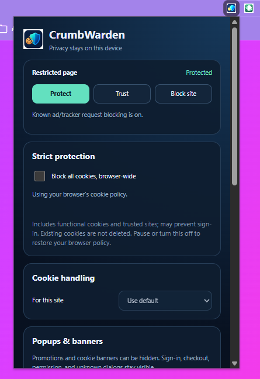
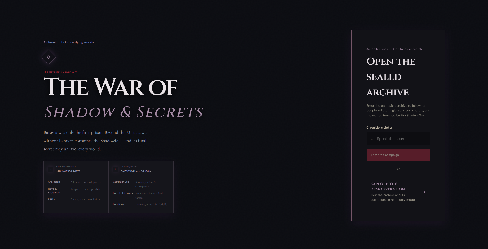

# Alexander Stack

**Software Engineer · Angular & TypeScript · Full-Stack Applications & Developer Tools**

[Portfolio](https://alexstackcodes.com) · [Email](mailto:alex_stack012@live.com) · [LinkedIn](https://www.linkedin.com/in/alex-stack)

I'm a software engineer with nearly five years of professional experience developing enterprise applications, full-stack systems, and developer tools. My enterprise work spans healthcare and global financial services, with a focus on reusable frontend architecture, API-driven workflows, and automated testing.

My primary expertise is Angular, TypeScript, and JavaScript, with additional experience building REST APIs, PostgreSQL-backed applications, and testing infrastructure.

I'm also the founder of **Full Stack Innovations LLC**, where I develop and maintain production applications, browser extensions, Custom web applications and AI-powered developer tools. I own the work from architecture and implementation through QA, deployment, and production support. 

## Engineering experience

- **Enterprise Software Engineering:** Built and maintained full-stack applications at Centene, Outspoke and Doran Jones, including reusable components, API integrations, validation workflows, and role-based functionality while staying in compliance with best practices, HIPPA and international regulations.
- **Test efficiency:** Reduced runtime by approximately **40%** in a suite of **6,000+ unit tests** at Centene by removing duplicate and unused tests, refining flaky tests, while increasing code coverage.
- **Production delivery:** Shipped browser extensions across **five browser targets and two distribution builds**, handling differences in APIs, permissions, storage, packaging, and release workflows.

## Featured projects

### StackApply

**Live product · Private source · 650+ users**

A cross-browser extension for job application form automation. Detects form fields, evaluates matches through confidence-based scanning, and autofills multi-page workflows while preserving manual review before submission.

**Engineering focus:** WebExtension APIs, reusable field detection, local-first data, cross-browser compatibility, and release QA.

[Chrome Web Store](https://chromewebstore.google.com/detail/stackapply/pmbednfckdcfdkceghlabjccinicomnp) · Also available on [Firefox] (https://addons.mozilla.org/en-US/firefox/addon/stackapply/)

### CrumbWarden

**Live product · Private source · 650+ users**

A privacy-focused browser extension for ad and tracker blocking, cookie consent automation, and website-specific protection controls. Uses a local-first architecture with no external data collection.

**Engineering focus:** Declarative network request filtering, browser security and permissions, local storage, configurable privacy controls, and cross-browser releases.

[Chrome Web Store](https://chromewebstore.google.com/detail/crumbwarden/kapdihhclmdnakebaanlfcoonimflkal) · Also available on [Firefox] (https://addons.mozilla.org/en-US/firefox/addon/crumbwarden/)

### Tabletop Campaign Archive

A full-stack campaign-management application with authenticated editor workflows and a protected, read-only portfolio demo.

**Engineering focus:** Angular 21, Express REST APIs, normalized PostgreSQL schemas, transactional CRUD operations, signed sessions, role-based authorization, cloud deployment, and automated API and browser tests.

[Source code](https://github.com/alexstack012/TTCA) · [Live demo](https://archive.alexstackcodes.com)

### Nix

An AI developer tool focused on local AI integration and agentic workflows.

**Engineering focus:** Local model integration, tool permissions, and security controls for agent workflows.

## Technologies

## Contact

For engineering roles or project inquiries, reach me at **[alex_stack012@live.com](mailto:alex_stack012@live.com)**.

For custom application development or more information about available products, visit **[Full Stack Innovations (FSI)](https://fullstackinnovations.com/)**.

Based in Minneapolis, Minnesota. Explore more work at **[alexstackcodes.com](https://alexstackcodes.com)**.
